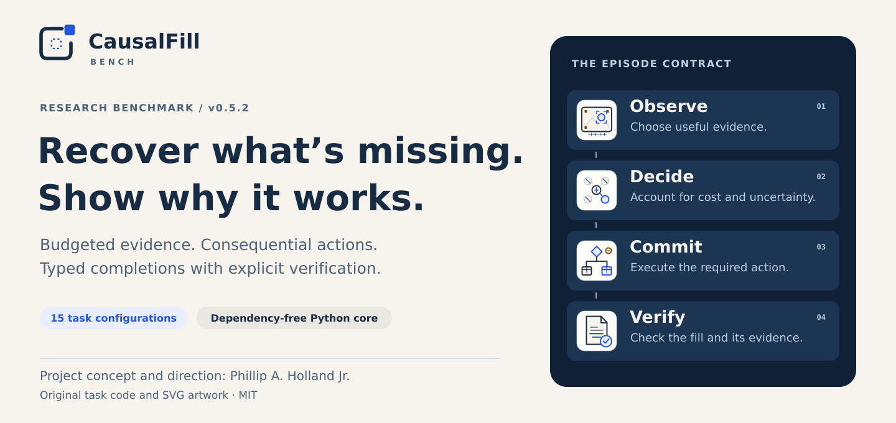
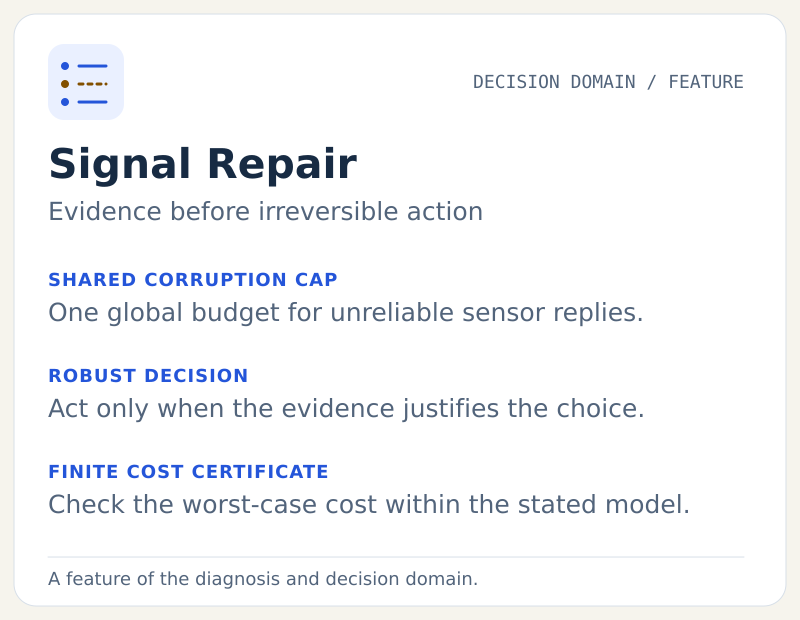

# CausalFill-Bench

<picture>
  <source media="(max-width: 700px)" srcset="branding/v052/hero-mobile.svg">
  
</picture>

**An executable research benchmark for recovering missing components, choosing evidence, and completing a procedure that works.**

CausalFill-Bench is an original, executable research prototype for tool-using agents. An agent encounters missing words, code, rules, procurement parameters, scene state, a mathematical operator, a proof, or a diagnosis. It must use a bounded public tool interface, produce a typed completion, and satisfy an independent verifier. Some tracks require a checked certificate as well as a recovered answer.

**Version 0.5.2 makes results easier to inspect and releases easier to reproduce.** Signal Repair now preserves the actual committed outcome when a certificate is malformed or an episode ends without a valid completion. Scoring versions stay separate, equivalent sensing mechanisms share a structural cluster, and a new offline review page connects scores to individual episodes. A checked package inventory protects the archived evidence and source files. The expanded SVG system includes all **15 task configurations across nine conceptual domains**.

The benchmark remains a research prototype. Scripted controls establish executable mechanisms; broad model performance and physical-robot transfer require separate experiments. The preserved Lean work establishes selected formal statements under its declared assumptions. See [v0.5.2 measured results](docs/v0.5.2-results.md), [the feature guide](docs/feature-guide.md), and [the next evaluation stage](docs/evaluation-plan-v0.5.1.md).

**Explore:** [Quickstart](docs/quickstart.md) · [Task map](#what-is-implemented) · [Features in depth](docs/feature-guide.md) · [Run review](docs/run-review.md) · [Release results](docs/v0.5.2-results.md) · [SVG gallery](branding/v052/index.html) · [Changelog](CHANGELOG.md)

Project concept and direction: **Phillip A. Holland Jr.** Implementation and research synthesis: AI-assisted. Original task code and assets are provided under MIT. No ARC tasks, third-party skills, robot assets, or OpenAI model weights are bundled. Serialized Lean proof dependencies retain their upstream terms; [the official upstream notices](formal/licenses/README.md) are included.

## Run it now

Python 3.10 or later; the benchmark core has **no third-party runtime dependencies**. From this directory:

```bash
python -m causalfill list
python -m causalfill --version
python -m causalfill demo --family robust_sensing --split transfer --difficulty 3
python -m causalfill demo --family visual --split transfer --difficulty 3
python -m causalfill demo --family robotics_vision --split transfer --difficulty 3
python -m causalfill demo --family latent_sparse --split transfer --difficulty 3
python -m causalfill demo --family vending --split transfer --difficulty 3
python -m causalfill demo --family vending_adaptive --split transfer --difficulty 3
python -m causalfill demo --family robotics_barrier --split transfer --difficulty 3
python -m causalfill demo --family proof --split dev --difficulty 2
python -m causalfill demo --family diagnosis --split transfer --difficulty 3
python -m unittest discover -s tests -v
```

On Windows, `py` can replace `python`. The code was exercised on Linux/Python 3.12 in this release; the CI configuration covers other versions but has not been run on GitHub here. A GPU is not needed for the simulators. Model inference is a separate client.

Run paired, reproducible controls and keep their traces:

```bash
python -m causalfill suite --output private-runs/evidence \
  --splits train dev transfer --difficulties 1 2 3 --count 5 \
  --policies evidence blind abstain
```

The output directory must be new or empty. `records.jsonl`, `summary.json`, `manifest.json`, and per-episode traces are produced. Seeds, private outcomes, and source fingerprints belong to the evaluator. Do not mount these into an agent container. The default suite includes both paired variants. Their intervention type depends on the track, as described below.

Build an interactive review of that run, then open the HTML file locally:

```bash
python -m causalfill review private-runs/evidence \
  --output private-runs/evidence-review.html --verify-traces
```

The review is self-contained and works offline. It separates policy/model/harness/scoring configurations, filters episodes, exposes certificate failures and resource use, and checks supplied manifest and trace bindings. It contains evaluator data; it is not a solver interface. [Review guide](docs/run-review.md).

## What's improved in v0.5.2

| Improvement | Resulting behavior |
|---|---|
| Correct operation diagnostics | A successful committed action remains visible as `outcome: 1` even if its final certificate is rejected. Strict success stays false. |
| Explicit scoring semantics | New records carry `causalfill.scoring.v2`; legacy records cannot silently merge into the same group. |
| Canonical structural grouping | The equivalent one-bit repetition mechanisms in train and dev contribute one structural cluster within the sensing family. |
| Offline run review | Inspect complete configuration scores, task breakdowns, pairs, costs, provenance and individual records in one HTML file. |
| Complete release packaging | Restored historical logs and C frontend sources are pinned by hash; the current source inventory checks archive and checkout completeness. |
| Expanded visual identity | Versioned heroes, all-configuration icons, explanatory feature plates and a responsive SVG gallery have deterministic source builders. |

[Migration notes](docs/migration-v052.md) explain the metric/schema changes. [Release instructions](docs/releasing-v052.md) describe verification and packaging.

## What is implemented

| Task key | Missing component | Tool behavior and verification |
|---|---|---|
| `words` | Literal routing words and conditions | Chosen Boolean experiments; exhaustive truth-table verification; causal or matched-slot-count random masks |
| `workflow` | Executable arithmetic expression | Restricted AST interpreter; sufficient symbolic equivalence and bounded-totality certificate over a declared integer domain; behavioral diagnostics |
| `grid` | Short transformation program | Original grid demonstrations and active experiments; typed DSL and finite behavioral tests |
| `vending` | Procurement rules and receipt timing | Real mutable simulation: purchases, delays, expiry, price, cash and time; full-horizon operating and accounting goals |
| `vending_adaptive` | Procurement terms and a contingent purchasing procedure | Hidden demand, informative experiments, irreversible orders, receipts, expiry and cash; exact finite operational-game cost certificates |
| `robotics` | Target position, safe path and handling condition | Three calibrated symbolic cameras and obstacle sensing; exact decimal-rational workspace/collision predicates in a simplified 3D scene |
| `robotics_barrier` | A route through an initially hidden gap | Paired full-height barriers with a checked separating-plane certificate; no common valid path, although each scene has a constructive solution |
| `latent` | Affine operator in 8, 32 or 100 variables | Exact finite-field probes, an affine certificate and dense interventions |
| `latent_sparse` | Sparse affine operator under scarce observations | Nine total cost units; a five-vector-probe constructive reference; same exact verification |
| `ambiguity` | An intentionally unobservable route word | Two distinct required answers have identical permitted observations; abstention evaluated separately |
| `proof` | A proof of a fixed signed conclusion | SHA-256 statement binding, a checked resolution refutation, and a satisfying assignment for the original premises |
| `diagnosis` | A hidden candidate-world identity | Adaptive binary experiments under a certified exact worst-case query cap; observed elimination witnesses must exclude every other world |
| `visual` | Target pose, relational object count, and executable routing choice | Actual PNG pixels; three-landmark affine calibration; occlusion, bounded noise, palette changes and target-translation twins |
| `robotics_vision` | A sensing and handling procedure before simulated delivery | Rendered scene evidence, contact/friction observations, sensing cost, irreversible execution and legal robust alternatives |
| `robust_sensing` | An action and the evidence justifying it despite faulty probes | One global corruption cap, once-only sensors, exact finite worst-case probe-plus-action budget, actual commitment and observed exclusion witnesses |

The paired configurations share conceptual domains: words/ambiguity, latent/latent_sparse, robotics/robotics_barrier/robotics_vision, vending/vending_adaptive, and diagnosis/robust_sensing. Together with workflow, grid, proof, and visual perception, that makes nine conceptual domains and fifteen configurations. Five vector probes in 100D return 500 field values, not five scalar measurements. Tool cost is a synthetic resource convention, not dollars, tokens, or floating-point operations.

The computer interface is a **virtual workspace plus typed tools**, not a real desktop/browser benchmark. The original robotics tracks use numerical projections. The new visual and robotics_vision tracks use controlled 2D raster images and a small simulated action model. Physical actuators, natural-image recognition, 3D contact dynamics, and robot transfer remain separate experimental layers.

## Signal Repair: evidence before commitment



One listed world is fixed. Each probe has a public truthful binary response in
each world, a positive cost, and one permitted use. At most `k` answers may be
flipped across the whole episode. A candidate world remains feasible while its
total disagreement count is at most `k`; that allowance never resets.

Actions can succeed in overlapping sets of worlds. The solver should gather
enough evidence to justify a successful action, preserve resources to execute
it, and then commit. The final fill binds to the public contract and cites
`k+1` distinct accepted probe observations against every world where the chosen
action would fail. A valid universal bypass can require no sensing.

The new engine computes an exact finite worst-case cost. A separately written
checker validates all alternatives, a policy verifier replays legal corruption
paths, and an independent development oracle enumerates complete fault-pattern
atoms. The Lean development proves generic accounting, witness and action
soundness; it does **not** prove the Python optimizer or physical sensors.
See [the task contract](docs/robust-sensing.md), [certificate semantics](docs/robust-decisions.md),
and [the formal record](formal/verification-v051-fault/README.md).

```bash
python tools/stress_robust_v051.py --cases 256 --runtime-seeds 3 \
  --output private-runs/robust-stress
python tools/stress_robust_ablation_v051.py --seeds 5 \
  --output private-runs/robust-ablations
```

## Retained v0.5 image-to-action extension

The rendered observations are generated from private scene geometry, but the
public payload contains only PNG bytes, dimensions and an integrity hash. The
scripted pixel reference decodes those bytes and recovers calibration from
visible landmarks. The scorer checks the independent latent geometry and action
outcome. Images with a fully hidden target are byte-identical across the tested
causal twins, including compression and metadata.

Visual QA includes an independent PNG decoder, exact small-raster pixel oracles,
noise-support checks, subpixel calibration checks, object visibility checks,
paired interventions, malformed-image controls and annotated contact sheets.
Blank-image and paired-image-swap experiments test whether the reference's
success actually depends on the delivered pixels. An annotated evaluator gallery
must never be supplied to a scored solver.

The finite decision-sufficiency module permits overlapping noisy observation
supports and multiple successful actions. It can check that an agent has enough
information to choose an action even when it cannot uniquely identify the world.
It also accepts a robust action that makes further sensing unnecessary. The
optimizer, all-alternative certificate checker and fixed-world policy replay are
separate procedures; an independent small-policy enumeration audit checks their
answers on a complete tiny corpus. These are bounded Python certificates; no
new Lean theorem or renderer-to-physics refinement proof is claimed.

```bash
python tools/stress_decision_v05.py --cases 256 --output private-runs/decisions.json
python tools/stress_vision_audit_v05.py --output private-runs/vision-audit.json
python tools/stress_visual_interventions_v05.py --seeds 4 --output private-runs/image-interventions
python tools/render_visual_qa.py --seeds 8 --output private-runs/image-gallery
```

The benchmark core remains dependency-free. The gallery and report builders use
Pillow and ReportLab only as development tools. For a vision-capable external
solver, copy [the standalone image client](clients/image_client.py) into its
isolated environment: it saves exactly the PNGs delivered by the public HTTP
interface and returns their local paths, with no evaluator imports. Model
inference and enforced isolation must be supplied by the evaluation host.

The original **100D** tasks remain finite-field algebra. Five 100-component
vector probes deliver 500 residues. Adding image tasks does not convert those
variables into physical dimensions or establish improved real-world perception.

## What the earlier certificates establish

**Sequential decisions:** a complete finite-game certificate gives the minimum worst-case action cost of guaranteed success. Its checker reconstructs every legal alternative; a separate checker replays the selected strategy from every possible initial world. The new market requires demand-dependent decisions. For two/three/four rounds, the certified operational costs are 8/12/16 in train and 9/13/17 in dev; transfer has 8/13/17. All three restricted policy classes lack a guaranteed-success strategy in the audited profiles. `no_observe` still receives operating feedback; `open_loop` ignores every observation. These costs exclude setup reads, static quotes and fill reconstruction. See [Adaptive vending](docs/vending-adaptive.md) and [Finite belief games](docs/finite-belief-games.md).

The optional [information assurance development](docs/formal-information.md) proves generic lower/upper strategy bounds and exactness in Lean. Four concrete policy-mode arenas of one two-round, four-world market receive checked profiles and separate equality proofs binding the entire imported arena to independently rendered expected data. This is distinct from proving the Python runtime or its belief projection correct. The release's exact theorem inventory and external-kernel results are listed in its verification manifest.

**Proof:** the agent receives immutable premises `F`, a signed goal `g`, and their SHA-256 digest. It submits a resolution refutation of `F AND NOT g` plus a concrete Boolean assignment satisfying `F`. A separate Python checker computes every inference. Both obligations must pass: the proof establishes the conclusion, while the satisfying assignment prevents vacuous credit from inconsistent premises. The agent cannot replace the theorem, add an axiom, or submit an unchecked derived clause. See [Proof track](docs/proof-track.md).

**Diagnosis:** the public file enumerates a finite noiseless table of possible worlds and experiment responses. An independent recurrence checker validates the minimum worst-case adaptive query depth, and a separate decision-tree checker validates an attaining strategy. The agent must work within that cap and identify the current world. Its final answer must name an actually observed experiment eliminating every competing world; a lucky correct guess is insufficient. See [Identification track](docs/identification-track.md).

These are bounded guarantees under explicit semantics. The optional [Lean assurance project](formal/README.md) proves resolution, indexed-checker and model-checker soundness, and the rule deriving nonvacuous entailment from checked proof and model witnesses. The two exported statements have checked consistency witnesses. The complete 865-step model artifact and 6,018-step reference artifact have each been checked by Lean 4.35.0, with their actual Lean definitions round-tripped against the exact input statements and certificates. No `sorry`, custom axioms, or `native_decide` proof shortcuts are used. Generic equivalence between the Python implementation and Lean checker has **not** been proved. The diagnosis and workflow checkers remain ordinary Python. The [assumptions document](docs/assumptions-and-guarantees.md) and [formal assurance scope](docs/formal-assurance.md) state the remaining trusted components.

**Workflow:** accepted expressions must have a sufficient symbolic equality and intermediate-value bound certificate over the published integer input box subject to the explicit task constraints, including `reserve <= ceiling` in transfer. This prevents an expression from receiving strict success merely by matching finite examples. The checker is deliberately incomplete: `not_certified` does not mean mathematical inequivalence. See [Workflow certification](docs/workflow-certification.md).

**Barrier robotics:** a checked pair construction shows that the two feasible hidden scenes share no valid continuous path. A geometry-dependent observation is necessary to guarantee solving both; either lidar or a suitable path probe may distinguish them. This establishes information necessity, not language-model computational hardness. See [Barrier profile](docs/robotics-barrier.md).

To check an exported proof independently of task generation or proof search:

```bash
python -m causalfill.verify_proof trusted_statement.json fill.json \
  --expected-sha256 "YOUR_TRUSTED_64_CHARACTER_LOWERCASE_SHA256"
```

Use a digest obtained from the trusted evaluator or another trusted channel, and replace the placeholder. `fill.json` contains the certificate object without the surrounding tool-call envelope. A digest supplied only by the claimant cannot establish that the intended theorem was proved. The command checks the fixed statement, resolution derivation and consistency witness and exits unsuccessfully if any obligation fails.

### Interpret paired variants by type

| `twin_kind` | What changes | Appropriate interpretation |
|---|---|---|
| `causal_parameter` | One declared parameter such as supplier lead time, camera/geometry condition, or operator coefficient | Robustness under that simulator's controlled parameter change |
| `wall_y_translation` | The y location of a full-height wall; all camera data and public files stay fixed | Route sensing under a checked no-common-path construction |
| `theorem_polarity` | The signed output convention and its occurrences in the fixed proof statement | Binding the proof to the actual specification |
| `diagnostic_state` | Which categorical world is current, with the response table unchanged | Identifying different states from their observations |
| `demand_trajectory` | Complemented demand sequence with the public candidate table and economic terms fixed | Selecting purchases under changed hidden demand; separate reset episodes |
| `target_horizontal_translation` | The target's world x coordinate, holding nuisance geometry, palette, camera and fixed noise constant | Pixel-derived pose, relational count and dispatch-rule correctness |
| `gate_lane` | Which rendered gate opening is usable, holding contact parameters and nuisance state fixed | Geometry-dependent route choice and simulated execution |
| `surface_friction` | Initial friction regime, holding images, geometry and public action laws fixed | Sensor-dependent handling or a valid contact-conditioning alternative |
| `sensor_corruption` | The assigned faulty-probe set, with the true world and public contract fixed | Robust evidence and action under the declared global cap; an assigned fault may remain unobserved |

Paired variants are separate episodes with reset agent state. Their joint success is not a measurement of online adaptation, and theorem-polarity or diagnostic-state pairs are not physical causal interventions.

## Use an actual agent

Start one private evaluator episode, setting `CFB_TOKEN` to a fresh random secret of at least 24 characters:

```bash
python -m causalfill serve --family latent_sparse --split transfer \
  --difficulty 3 --seed 7814 --output private-runs/agent
```

Copy only [the HTTP client](clients/http_client.py) into the agent's environment. Give it `CFB_URL` and the episode token. It can call:

```bash
python http_client.py episode
```

For a tool call, send JSON on stdin to `python http_client.py tool`:

```json
{"tool":"read_file","arguments":{"path":"/workspace/operator.masked.json"}}
```

The final call is:

```json
{"tool":"submit","arguments":{"fill":{},"confidence":0.7,"abstain":false,"evidence":["e0001"]}}
```

Replace `fill` with the task's required object. `confidence` estimates whether the submitted decision is correct, including a justified abstention. Submission acceptance does not reveal success. A session accepts one final submission; grade and trace are saved only on the evaluator host. See [Protocol](docs/protocol.md).

`python -m causalfill stdio ...` supplies a JSON-lines alternative. It emits the public task first and accepts one `{tool, arguments}` request per line, saving the private grade separately.

**Isolation matters:** the HTTP interface filters observations but is not an OS sandbox. An evaluated agent must not have filesystem/process access to this package, reference policies, seeds, private logs, or the evaluator. Use a separate container or VM and an appropriately restricted connection. A public generator or seed alone is not a secret test set. There is no certified hosted leaderboard in this release.

## Scores and experimental controls

The primary capability measure is macro-averaged strict success over answerable task family labels. Correctly abstaining on an unanswerable control does not increase it. The implemented labels keep challenge configurations separate from their base configurations; a nine-conceptual-domain average would require an explicit, pre-registered remapping. Reports also show:

- Recovery and executable outcomes.
- Success on both members of a complete pair, interpreted by its intervention type.
- Coverage, answered accuracy and unanswerable-case abstention.
- Decision-confidence Brier score.
- Tool cost, call count, invalid calls, and elapsed time.
- Canonical serialized request/response bytes in suite records.
- Structural-cluster uncertainty, with intervals withheld when templates are insufficient.

`evidence` is a **task-aware scripted reference** that obtains its information through the public tool callback. `oracle` is a privileged evaluator diagnostic. `blind` and `abstain` are deliberately weak controls. None is an LLM evaluation. [Scoring details](docs/scoring.md).

Optional conditions include `--no-skill`, `--no-tools`, and `--mask-strategy random`. The no-skill condition removes only the generic recovery guide; task-specific grammar remains part of the task. The no-tools condition is **prompt-only**, not a fair static-versus-active comparison with identical evidence; it is unsuitable for the operational vending task as a substantive capability comparison. Causal/random masking currently applies only to `words`; the other tasks use fixed domain-specific gaps. The mask planner uses a dependency-graph influence proxy, not a trained adversarial generator or a tokenizer-exact matching claim.

## Stress findings and reproducibility

The preserved v0.4 release passed **214 unit/integration tests** and a **3,240-episode scripted control matrix**, with all 990 answerable evidence-reference episodes succeeding. New finite-game audits include 1,024 independent optimum comparisons, 601,600 complete small syntactic policies, an analytic set-cover oracle, and 27 generated market graphs containing 83,616 states and 139,080 executed transitions. The runtime audit uses one canonical history per projected state and every outgoing edge; it is not enumeration of every history. See the [versioned results](docs/v0.4-results.md) for exact counts, sources, proof gates and limitations.

The v0.3 audit found and repaired three evaluator gaps: geometry epsilon errors near boundaries, workflow expressions that pass every finite case but diverge elsewhere, and different JSON acceptance rules across HTTP and stdio. Metric aggregation now also preserves finite extreme and subnormal means. Independent review repaired a Boolean/numeric JSON alias in the new barrier observation-equivalence checker. Before-fix evidence is retained beside the follow-up results; check counts are not independent task counts.

The v0.3 audit found two valid strategies that remain accepted: a fixed Express-supplier schedule for original vending and a high-clearance route with constant grip force for original robotics. The barrier profile addresses route-information necessity. Version 0.4 adds a separate adaptive procurement profile whose operational necessity and cost are checkable; it does not retrospectively invalidate those original solutions. The assistant pilot also found a valid direct-assay policy, confirming that the new scorer accepts successful alternatives to the forecast-based reference.

```bash
python tools/stress_formal.py --output private-runs/formal-stress.json
python tools/stress_operations.py --seed-count 64 --metamorphic-seed-count 16 \
  --geometry-cases 20000 --actions-per-episode 80 \
  --output private-runs/operations-stress.json
python tools/stress_protocol.py --output private-runs/protocol-stress.json
python tools/stress_belief_v04.py --cases 60 --output private-runs/belief-stress.json
python tools/stress_adaptive_v04.py --seeds 3 --output private-runs/adaptive-stress.json
# Optional: install the pinned official Lean 4.35.0 toolchain first.
python formal/verify.py --toolchain /absolute/path/to/lean-4.35.0-linux
```

The protocol harness opens actual loopback sockets. It verifies the stated transport/session properties; it is not a security certification for a hostile multi-tenant service. See [Release evidence](reports/README.md) for exact versions, commands, failures, repairs, and limits.

## Why this research direction is worth testing

The proposed contribution is to connect **structured missing components, deliberate information acquisition, executable consequences, certificates, and uncertainty** in one auditable protocol. Version 0.4 makes the guarantee-to-runtime relationship inspectable and tests complete alternative policies, not only intended reference trajectories. The ingredients have substantial prior art: code infilling, ARC-style induction, skills evaluations, Vending-Bench, active perception, belief-space planning, sparse identification, formal proof checking, and exact query learning. Axiom's checked-proof workflow, VERINA, and miniF2F are particularly relevant; they are discussed in [Related work](docs/related-work.md).

No claim of being the first, hardest, or a breakthrough is made. A publishable claim needs pre-registered comparisons against strong models, equal-budget controls, independent task review, genuinely private future families, and external replication. The [release gates](docs/release-gates.md) state what remains before a scientific leaderboard claim.

## Repository map

- `causalfill/`: evaluator, tools, domains, policies, metrics and CLI.
- `clients/`: small agent-side HTTP adapter without evaluator imports.
- `tests/`: behavior, numerical, accounting, leakage and protocol checks.
- `docs/`: specification, threat model, related work, scoring and domain explanations.
- `reports/`: measured development evidence and release verification.
- `formal/`: Lean source, complete exported proof sources, round-trip data, and verification logs.
- `tools/stress_*.py`: deterministic semantic, operational, and real-transport stress harnesses.
- `configs/`: research-source provenance and optional isolation example.
- `branding/v052/`: current SVG identity, task icons, feature illustrations and gallery.
- `reports/v052/`: source-bound v0.5.2 development checks and the offline review.

The **CausalFill Benchmark** companion skill provides author/evaluator and solver workflows. Its solver workflow excludes evaluator/source access. Skill installation is separate from the benchmark source distribution. The source package runs independently of that optional companion.

## Citation

Use [CITATION.cff](CITATION.cff) for the software. The title and version refer to an AI-assisted research prototype, not a peer-reviewed publication. URLs for all external methods are provided in the related-work and math documents.
