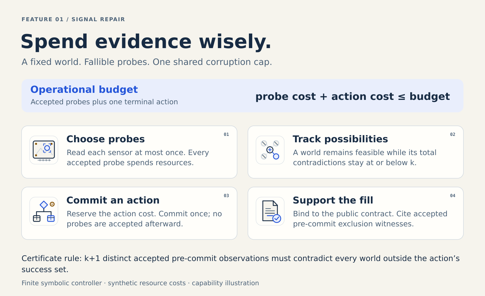
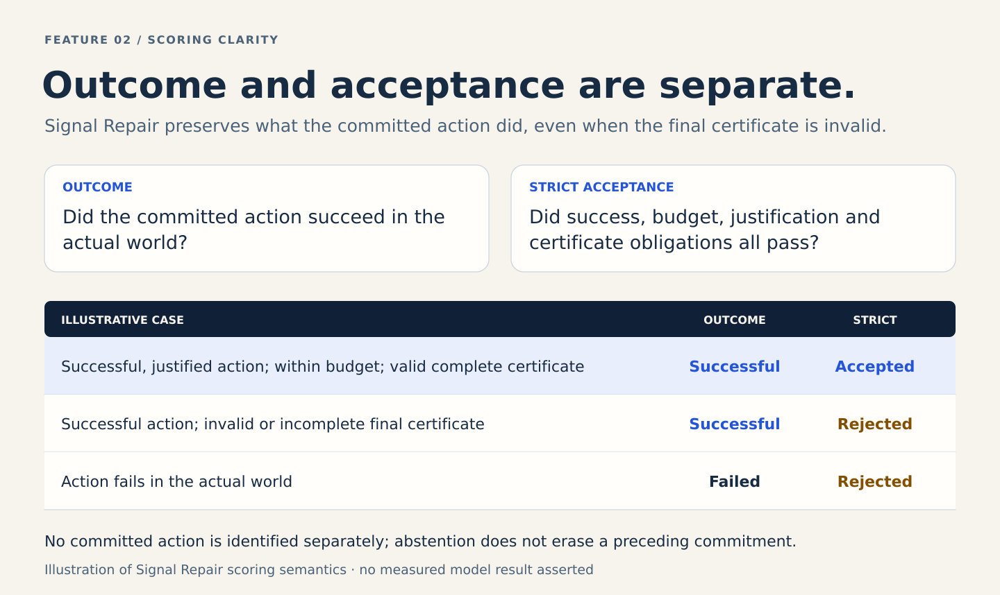
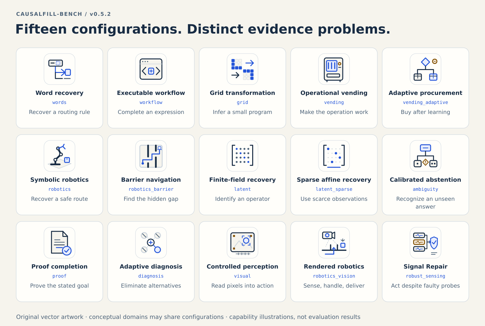
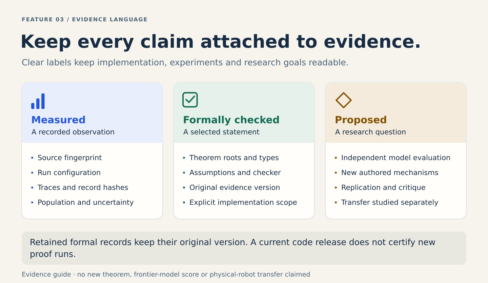

# Features in depth — CausalFill-Bench v0.5.2

CausalFill combines missing components, budgeted observation, executable consequences and explicit verification. Its value as a research instrument depends on what an experiment actually isolates. This guide connects each implemented feature to its interface, its evidence and its limits.

## 1. A missing component inside a working procedure

An episode presents a bounded task with a typed gap. The gap can be a routing word, executable expression, procurement term, hidden scene state, finite-field operator, proof or justified action. The agent sees a public description, virtual files and declared tool signatures. It does not receive the trusted evaluator's hidden state or grading result.

The final answer is a structured completion. Depending on the task, the evaluator runs it, checks a mathematical certificate, compares it with a declared finite specification, or inspects a real simulated state transition. Correct-looking prose is not the acceptance criterion. The exact obligations belong to each task contract; “verification” does not mean every Python component has been proved correct.

Sources: [registry](../causalfill/registry.py), [task types](../causalfill/types.py), [protocol](protocol.md).

## 2. Evidence with a price

Public tools have explicit costs and an episode has a declared budget. File reads, searches, experiments and task actions can consume resources. The agent must decide what is worth observing and how much to reserve for completion. Some task-specific budgets distinguish operational costs from setup costs; an unused setup credit cannot necessarily buy an operational action.

The relevant question is often whether the remaining uncertainty can change the action. An agent may not need to identify the precise hidden world if every feasible world admits the same successful action. Conversely, a lucky action in the actual world may lack enough evidence to justify a guarantee over all worlds compatible with the observations.

The budget is a synthetic benchmark convention. Report model tokens, inference latency, wall time and monetary cost separately when evaluating models. Tool-cost optimization in a finite game does not prove optimal CPU time or model reasoning efficiency.

Sources: [Session](../causalfill/session.py), [decision sufficiency](decision-sufficiency.md), [finite games](finite-belief-games.md).

## 3. Signal Repair: fallible sensing, one shared limit

<picture>
  <source media="(max-width: 700px)" srcset="../branding/v052/features/signal-repair-mobile.svg">
  
</picture>

Signal Repair fixes one true world from a finite public table. Each sensor has a truthful binary response in every world, a positive cost and one permitted use. At most `k` sensor answers can be flipped during the entire episode. The allowance belongs to the whole history; it does not reset after each observation.

A candidate world remains feasible if its total disagreement with the accepted observations is at most `k`. Different actions may succeed in overlapping world sets. The agent chooses a sequence of probes, keeps enough budget to execute the selected action, commits once, and then submits evidence for the action.

The final certificate names the public problem digest and the committed action. For every world in which that action would fail, it cites at least `k+1` distinct accepted pre-commit observations inconsistent with that world. Such a world cannot be the true world under the global corruption bound. Merely naming a correct action is insufficient.

Some transfer profiles admit a robust bypass action valid in every world. If its cost fits the public contract, it can be a legitimate zero-sensing solution. The benchmark accepts that alternative. Evidence gathering is justified by the decision problem rather than enforced as a ritual.

The cost engine computes an exact finite worst-case probe-plus-action cost. A separate certificate checker reconstructs alternatives; a policy checker replays legal paths; a development oracle expands fixed fault patterns into latent atoms. The retained Lean roots concern the declared mismatch, feasibility and witness semantics. They do not establish that every Python optimizer or real sensor is correct.

Sources: [task contract](robust-sensing.md), [cost and certificate semantics](robust-decisions.md), [runtime](../causalfill/domains/robust_sensing.py), [formal record](../formal/verification-v051-fault/README.md).

## 4. Outcome and acceptance are different measurements

<picture>
  <source media="(max-width: 700px)" srcset="../branding/v052/features/outcome-acceptance-mobile.svg">
  
</picture>

Version 0.5.2 makes this distinction reliable in Signal Repair's failure paths. Actual outcome is derived from the action committed in the environment. Robust justification is derived from the observations available before that action. Certificate acceptance is derived from the final fill. The three cannot be substituted for one another.

For example, an agent can execute a successful, justified action and then submit the wrong public-problem digest. Its strict submission fails while the successful operation remains recorded. An agent can also choose an action that happens to work while other feasible worlds would make it fail: outcome succeeds, but robust justification fails. Abstaining after an action does not undo that action.

These cases help diagnose a system's behavior. A test-design demonstration using deliberately restricted scripts is not evidence that a particular AI model makes the same mistakes. A measured model claim requires a separately identified model, frozen harness, permitted observations and recorded conditions.

Sources: [scoring](scoring.md), [migration](migration-v052.md), [focused scoring audit](../tools/audit_scoring_v052.py).

## 5. Fifteen configurations, nine conceptual domains

The runtime uses fifteen `family` labels. Challenge configurations that share a conceptual domain retain separate metric weights. A nine-domain average would require an explicit remapping registered before analyzing results.

| Configuration | What must be recovered or achieved | What the verification covers | Detailed contract |
|---|---|---|---|
| `words` | Routing words and Boolean conditions | The completed rule across a finite truth table | [Research specification](research-spec.md) |
| `workflow` | A restricted arithmetic expression | Sufficient symbolic equality and intermediate-value bounds over a declared domain | [Workflow certification](workflow-certification.md) |
| `grid` | A small transformation program | An original typed grid DSL and finite behavioral checks | [Grid track](grid.md) |
| `vending` | Procurement rules plus a successful operating history | Inventory, receipts, expiry, cash and service over a simulated horizon | [Research specification](research-spec.md) |
| `vending_adaptive` | Contingent procurement under hidden demand | Executed operations and bounded finite-game cost certificates | [Adaptive vending](vending-adaptive.md) |
| `robotics` | Target pose, path and handling condition | Simplified geometry and collision predicates | [Symbolic robotics](robotics.md) |
| `robotics_barrier` | A feasible route through a hidden barrier gap | A checked pair construction with no common valid path | [Barrier profile](robotics-barrier.md) |
| `latent` | A dense affine operator | Exact finite-field reconstruction under declared probes | [Finite-field mathematics](math-and-100d.md) |
| `latent_sparse` | A sparse affine operator with scarce observations | The same exact reconstruction contract with a tighter resource profile | [Finite-field mathematics](math-and-100d.md) |
| `ambiguity` | Recognizing that the answer is not observable | Two incompatible answers with identical permitted observations; abstention scored separately | [Scoring](scoring.md) |
| `proof` | A proof of a fixed signed conclusion | Statement binding, resolution refutation and a consistency witness | [Proof track](proof-track.md) |
| `diagnosis` | The true world in a noiseless finite table | Exact worst-case query cap and actually observed elimination witnesses | [Identification track](identification-track.md) |
| `visual` | Pose, relational count and routing choice from PNGs | Controlled pixels, calibration and the declared tolerances/rule | [Controlled perception](visual-perception.md) |
| `robotics_vision` | A sensing-and-handling procedure leading to delivery | Actual irreversible simulated execution with image/contact evidence and robust alternatives | [Rendered robotics](robotics-vision.md) |
| `robust_sensing` | A successful action justified despite faulty probes | One global fault cap, operational budget and accepted exclusion witnesses | [Signal Repair](robust-sensing.md) |

The visual tracks use controlled rendered scenes. They do not establish natural-image recognition or physical-robot transfer. The 100-dimensional algebra tracks operate on finite-field vectors; a five-vector-probe protocol can return 500 scalar residues. These distinctions matter when comparing information budgets.

## 6. Paired changes and uncertainty

Paired episodes hold a controlled part of the task fixed while changing a declared factor. Their joint success tests whether both variants work. The exact interpretation is recorded in `twin_kind`: examples include a barrier translation, theorem polarity, demand trajectory, gate lane, friction regime and sensor corruption assignment.

Each twin is a separate episode with reset state. Joint success does not by itself demonstrate online learning or reveal an agent's internal reasoning. Assigned sensor corruption can remain unobserved if the affected probe is never used.

New seeds do not create independently authored mechanisms. Summaries bootstrap `structural_signature` clusters within each family and disclose cluster counts. When any participating answerable family has fewer than two structures, the macro interval is withheld. An all-pass interval on a fixed corpus does not imply zero uncertainty on unseen tasks.

Version 0.5.2 gives the equivalent train-1/dev-1 sensing mechanism one canonical structural identity. It also groups by scoring version, preserving historical semantics when old and new records are analyzed together.

Source: [scoring and uncertainty](scoring.md).

## 7. An inspectable evaluator workflow

The CLI supports demonstrations, paired suites, HTTP or stdio episodes, trace checking, summary computation and an offline review. A suite emits a manifest, per-episode records, grouped summaries and tool traces. The review verifies supplied bindings, separates configurations and lets the evaluator inspect a failure directly.

The core has no third-party runtime dependencies. Visual and report authoring use optional development tools. The source distribution includes generated SVGs and gallery files, so viewing the identity does not require a design toolchain.

For model evaluation, host the evaluator in a separate environment and provide only the public client. Do not expose source, reference policies, hidden seeds or private records to a scored solver. The transport itself is not a process or filesystem sandbox.

Sources: [quickstart](quickstart.md), [review guide](run-review.md), [protocol](protocol.md), [evaluation plan](evaluation-plan-v0.5.1.md).

## 8. Evidence that keeps its scope

<picture>
  <source media="(max-width: 700px)" srcset="../branding/v052/features/evidence-language-mobile.svg">
  
</picture>

The project distinguishes three kinds of statement. **Measured** claims cite a recorded run and its source/configuration binding. **Formally checked** claims identify the theorem roots, types, assumptions and checker record. **Proposed** claims describe research questions still to be tested.

The package inventory protects bytes and completeness, including the restored v0.5.1 evidence. It cannot authenticate an experiment merely by hashing it. A retained formal log remains evidence of its original run; adding it to a new release does not constitute a fresh theorem build. A passing scripted suite remains a control suite, not thousands of AI evaluations.

The next scientific stage is to freeze conditions, evaluate identified strong models, add independently authored hidden mechanisms and equal-information baselines, and seek outside replication. The v0.5.2 work makes that stage easier to inspect and reproduce; it does not replace it.

Sources: [release results](v0.5.2-results.md), [formal assurance](formal-assurance.md), [release gates](release-gates.md), [brand guide](brand-v052.md).
